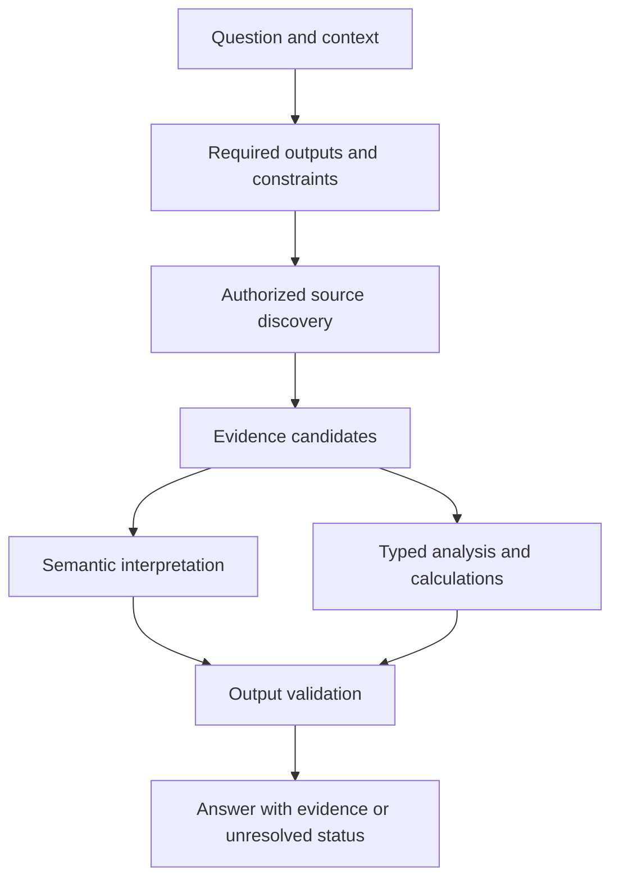

# 01 | Evidence-aware urban data reasoning

## Problem

Urban datasets are distributed across documents, tables, structured records, geospatial layers and engineering formats. Questions may require a combination of evidence retrieval, numeric calculations, spatial operations and interpretation of the source's limitations.

## Technical approach explored during the challenge

The development work explored question-first decomposition into required outputs, explicit constraints and reusable computational dependencies. Rather than delegating all numeric and geometric operations to a language model, the design separates semantic interpretation from typed data processing and evidence verification.

The diagram summarizes a research design; it is not a verified trace of the exact high-scoring submission. Development explored local small-language-model inference and deterministic processing of tabular, document and geospatial sources. No competition implementation or test content is included here.

## Reported competition outcome

| Item | Value |
| --- | --- |
| Competition | GenAI for Good Challenge: Cities Edition 2026 |
| Platform | Zindi |
| Public score | 0.922826003 |
| Submission identifier | gB79oiHv |
| Submission date | 26 November 2026 |
| Reported public rank | 15th (historical snapshot) |

The score and rank are participant-reported public leaderboard observations. They are not a claim of final placement, exact-answer accuracy, code-audit approval or independent reproducibility. [Competition page](https://zindi.world/competitions/GenAI-for-Good-Challenge).

## Relevance to Skopje

The design principles can support staff review of permit-derived planting obligations, location matching and traceable proposed updates to a green infrastructure register. Such adaptation is proposed work, not an existing municipal deployment.

## Release boundary

No contest questions, answers, source files, prompts, solver code or live submission download links are published while the competition is active.
