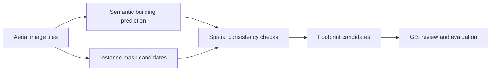

# 02 | High-resolution building extraction and change monitoring

## Problem

Urban aerial imagery contains adjoining roofs, narrow gaps, shadows, roads and bridges. Pixel-level building predictions alone may not provide clean individual building footprints suitable for GIS review.

## Engineering approach

The project explores complementary semantic and instance-level segmentation outputs, spatial consistency checks and generation of reviewable building footprints. Evaluation considers both pixel agreement and object-level failure modes such as merged buildings, missed roofs and duplicate instances.

Key engineering tasks include tiled inference, alignment of predictions with imagery, mask-to-vector conversion, spatial quality checks and comparison with reference annotations. Change monitoring additionally requires comparable acquisitions and careful treatment of registration and label differences.

## Evaluation approach

- Intersection over Union (IoU) and recall for the building class.
- Visual inspection of boundaries, adjoining objects and false positives.
- Separate reporting of development results and independent geographic validation.

Internal development and evaluation have been conducted. This public description does not disclose restricted imagery, exact model fusion logic, non-public benchmark figures or patent-related details. The [synthetic example](../examples/README.md) demonstrates only basic evaluation mechanics; it is not the project's production pipeline.

## Urban application

Reviewable building inventories can support planning, change monitoring and base-map maintenance. The same spatial quality-control principles are relevant to tree and green-space inventory updates.
