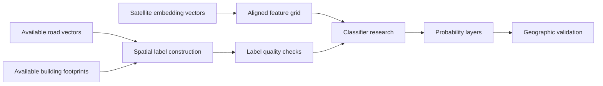

# 03 | Satellite embeddings for road and building mapping

## Research objective

Explore whether annual satellite embeddings and available vector labels can support scalable road and building mapping and later analysis of urban change. The initial work focuses on a local urban pilot rather than claiming global coverage.

## Approach

The research uses satellite embedding vectors as features, aligns vector supervision to a common spatial grid, and investigates lightweight classifiers for road and building probabilities. It distinguishes reliable labeled cells from mixed, partial and unmapped cells. Unmapped does not automatically mean absent.

## Evaluation and limitations

Local pilot work has investigated grid alignment, label coverage and sample audits. A global model, independent cross-city accuracy and robust annual change estimates are not established by that pilot. Important open issues include label completeness, geographic transfer, mixed pixels, temporal alignment and resolution limits. The embedding data are not a replacement for high-resolution footprint boundaries.

## Urban application

A validated workflow could support urban growth monitoring and provide context for city-wide infrastructure planning. Higher-resolution local records remain necessary where individual asset geometry matters.
