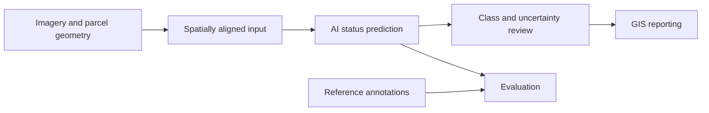

# 04 | AI-assisted land-use status monitoring

## Problem

Municipal land monitoring requires distinguishing idle plots, partly developed plots and developed plots. In aerial imagery the boundary between these classes can be ambiguous, especially when a parcel contains both construction and undeveloped areas.

## Engineering approach

The project investigates parcel-level interpretation using imagery and spatial context, comparing predicted status with reference labels and examining class-specific errors. Evaluation separates model changes from changes to reference annotations; correcting a label does not by itself demonstrate an algorithmic gain.

## Evaluation approach

The engineering work uses class-level IoU and macro-averaged metrics, with particular attention to partly developed parcels. Reference ambiguity, acquisition conditions and geographic transfer remain material limitations. Internal datasets, locations, metrics and implementation details are not included in this public portfolio.

## Urban application

A reviewable land-status workflow can assist inspection prioritization and consistent map updates. The system is intended to support human review, not to make automatic legal or enforcement decisions.
