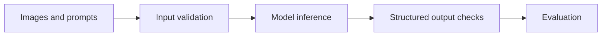

# Multimodal model training and inference engineering

**Area:** Language models & AI engineering  
**Status:** Experimental and engineering work

## Problem

Applied vision-language models must process images and structured outputs reliably under finite GPU memory and throughput constraints.

## Technical experience

Experience includes local model deployment, parameter-efficient fine-tuning, single-image and multi-image input construction, structured output validation, batch inference and diagnosis of memory or preprocessing failures. Work has explored small-model tool orchestration as well as domain VLM adaptation.

The diagram is a high-level description of the research workflow, not a release of the original implementation.

## Validation and boundaries

Performance depends on model revision, dataset, hardware and preprocessing. No general-purpose benchmark or production throughput figure is asserted.
