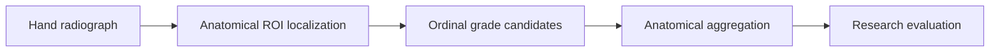

# Anatomically structured hand X-ray analysis

**Area:** Biomedical & scientific AI  
**Status:** Multi-stage computational research

## Problem

Bone maturity assessment benefits from explicit anatomical regions and interpretable per-bone predictions rather than a single unexplained age value.

## Technical experience

Work spans hand radiograph region detection, thirteen-bone region-of-interest extraction, ordered skeletal maturity grade prediction, global/local feature fusion and graph-based anatomical reasoning. Vision-language fine-tuning and uncertainty-aware aggregation were also investigated.

The diagram is a high-level description of the research workflow, not a release of the original implementation.

## Validation and boundaries

Some experiments used incomplete or proxy labels. Per-bone grades and age regression require distinct ground truth; independent clinician annotation and external validation are needed. No clinical diagnostic performance or regulatory clearance is claimed.
