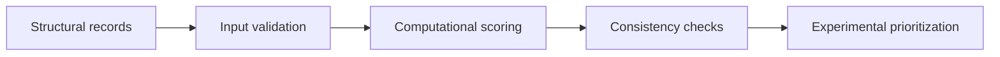

# Structure-based molecular research and docking

**Area:** Biomedical & scientific AI  
**Status:** Computational investigation; experimental validation pending

## Problem

Virtual screening must account for uncertain receptor geometry, molecular identity and inconsistent structural evidence.

## Technical experience

Work explored receptor and ligand preparation, docking controls, repeatability across random seeds, comparison of computational scores and screening against structural evidence. The project separates evidence availability from a model-derived ranking and treats uncertain inputs as unresolved.

The diagram is a high-level description of the research workflow, not a release of the original implementation.

## Validation and boundaries

Docking scores do not establish binding, activity or selectivity. Specific candidate structures, targets under unpublished development and novel method details are intentionally withheld.
