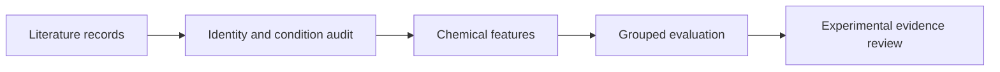

# Radiopharmaceutical chemistry informatics

**Area:** Biomedical & scientific AI  
**Status:** Exploratory data and modeling research

## Problem

Radio-metal coordination and labeling results depend on ligand structure and experimental conditions, and the literature can be sparse or inconsistent.

## Technical experience

Work investigated literature extraction, chemical identity and experimental-condition normalization, descriptor generation, small-sample model evaluation and evidence-aware candidate prioritization. Evaluation considers separation by ligand and publication to reduce leakage.

The diagram is a high-level description of the research workflow, not a release of the original implementation.

## Validation and boundaries

Small and heterogeneous datasets limit predictive confidence. Proposed ligands require novelty checks, synthesis and coordination or labeling experiments. No successful synthesis, radiolabeling or clinical performance is claimed.
