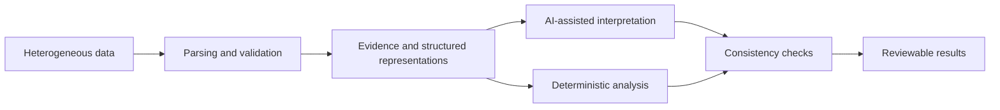

# AI & Geospatial Engineering | Technical Portfolio

**Applied artificial intelligence · Geospatial analytics · Evidence-grounded systems**

This portfolio presents selected applied research and engineering work relevant to urban data integration, remote sensing, and AI-assisted decision support. The emphasis is on translating heterogeneous data into reviewable outputs, combining learned models with deterministic computation, and making uncertainty visible to users.

## Featured achievement

**GenAI for Good Challenge: Cities Edition 2026 (Zindi)**

- Public leaderboard score: **0.922826003** (submission `gB79oiHv`, 26 November 2026).
- Reported public leaderboard position: **15th**, a historical snapshot, not a final ranking.
- The public score is a competition metric, not an independently measured accuracy on all 600 questions. Final private evaluation and eligibility review are separate.

## Selected projects

| Project | Technical focus | Development status |
| --- | --- | --- |
| [01 · Urban data reasoning](01_GenAI_Cities_Challenge/Architecture.md) | Evidence-aware multi-source question answering and deterministic computation | Competition assessment; deployment not claimed |
| [02 · Building extraction](02_Building_Extraction/Methodology.md) | Semantic segmentation, instance masks, spatial conflict resolution | Engineering development and internal validation |
| [03 · Global geospatial AI](03_Global_Geospatial_AI/README.md) | Satellite embeddings, vector supervision, building/road mapping | Local research pilot; global validation pending |
| [04 · Land-use monitoring](04_Land_Use_Monitoring/README.md) | Land-use status classification, spatial evidence and evaluation | Internal development and evaluation |
| [05 · Scientific AI](05_Scientific_AI/README.md) | Molecular representation, predictive screening and evidence checks | Computational research; experimental validation pending |

## Technical demonstration

A small, standalone [geospatial evaluation example](examples/README.md) illustrates pixel-level segmentation metrics and explicit treatment of excluded cells using **entirely synthetic data**. It is newly prepared for this portfolio, not production code or a competition solver. It runs with Python 3.9+ and the standard library only.

```bash
python3 examples/mask_evaluation.py
python3 -m unittest discover -s tests -v
```

## Engineering principles



The recurring design principles are data provenance, explicit task constraints, reproducible computation, separate development and evaluation, and human review where decisions have operational consequences.

## Relevance to sustainable cities

The work is relevant to municipal GIS maintenance, green infrastructure inventories, land-use monitoring and staff-facing decision support. Transfer to a new city requires local data permissions, language validation, representative acceptance tests and agreement with municipal stakeholders. No city deployment or partnership is claimed here.

## Scope and disclosure

This is a curated technical portfolio, not a release of employer-owned systems. Case studies are high-level descriptions of selected work; they do not imply sole authorship or grant rights to underlying intellectual property. Confidential datasets, non-public source code, competition questions and answers, and unpublished invention details are excluded. Internal metrics and project images are omitted unless cleared for release. The synthetic example is illustrative, not evidence of a deployed system.

GitHub: [newledge](https://github.com/newledge)
